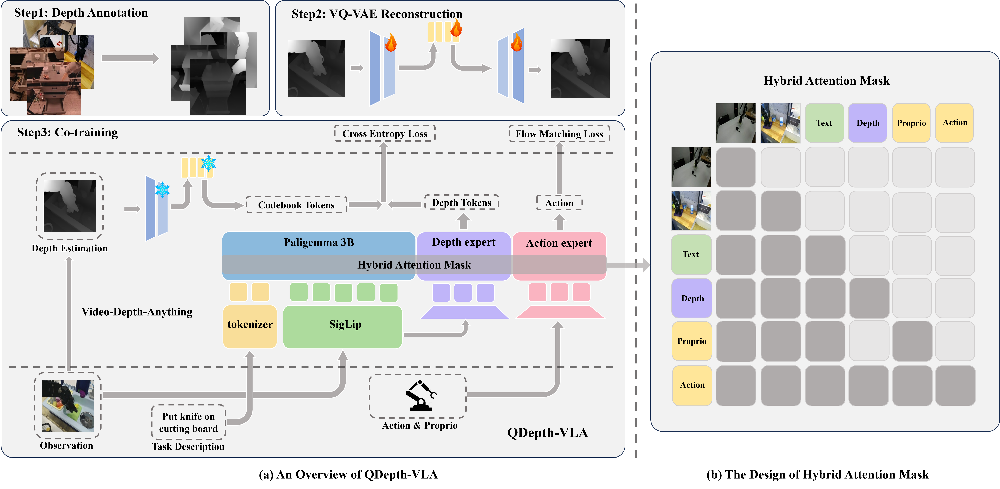
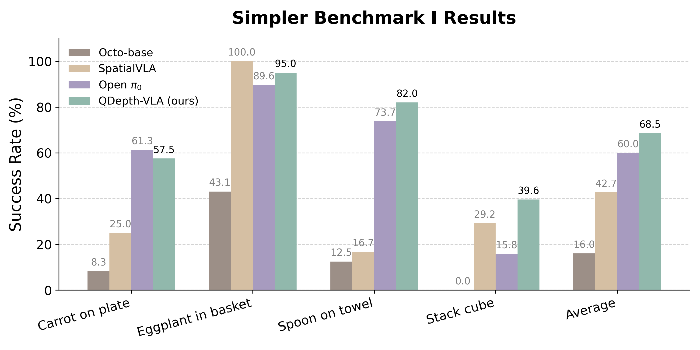
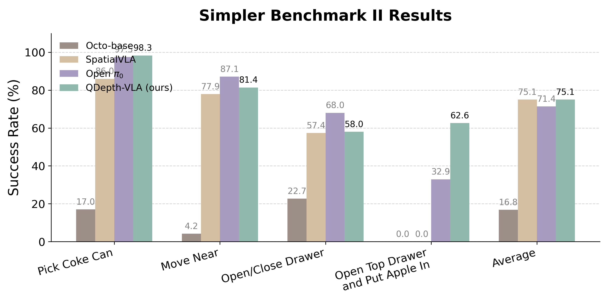
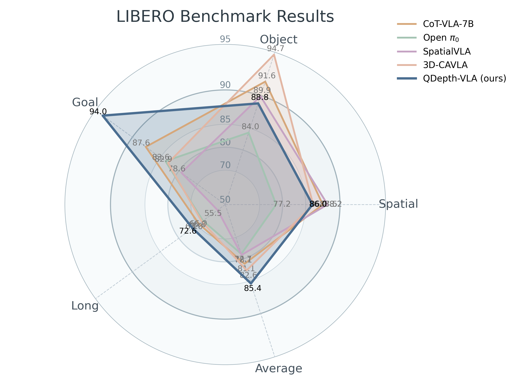

# <p align="center"> QDepth-VLA: Quantized Depth Prediction as Auxiliary Supervision for Vision-Language-Action Models </p>
<p align="center">
  📄 <a href="https://arxiv.org/abs/2510.14836"><strong>Paper</strong></a> |   
  🤗 <a href="https://www.modelscope.cn/models/liyixuan2026/QDepth-VLA"><strong>Model</strong></a> | 
  📁 <a href="https://huggingface.co/datasets/ucasmichael/fractal20220817_data"><strong>Dataset</strong></a>
</p>

QDepth-VLA is a depth-enhanced vision-language-action (VLA) model built upon the open-pi-zero [codebase](https://github.com/allenzren/open-pi-zero), which itself implements the pi0 model proposed by Physical Intelligence. The original pi0 model adopts a Mixture-of-Thought (MoT) architecture, where multiple modality-specific experts maintain independent parameters and interact solely through attention mechanisms.

Following this design, QDepth-VLA extends the MoT architecture by introducing an additional Depth Expert to explicitly model scene geometry and improve action generation quality. The overall model consists of a pre-trained PaliGemma 3B vision-language model (with 2.291B parameters fine-tuned), an Action Expert (0.315B parameters), and the newly added Depth Expert. Additionally, QDepth-VLA employs a hybrid attention mask that extends the original block-wise causal masking strategy of pi0.



## Installation
1. Clone this repository at your directory. If running Simpler or LIBERO eval, clone them to the same directory:
```console
git clone https://github.com/ucasmichael/QDepth-VLA

git clone https://github.com/allenzren/SimplerEnv --recurse-submodules
git clone https://github.com/Lifelong-Robot-Learning/LIBERO
```
> Note: For LIBERO, it is recommended to configure a separate virtual environment following the instructions in [LIBERO](https://github.com/Lifelong-Robot-Learning/LIBERO) to avoid dependency conflicts.

2. run the following in the repo directory:
```console
pip install -e .
pip install -e ../SimplerEnv
pip install -e ../SimplerEnv/ManiSkill2_real2sim
```
> **important**: There are known issues with tensorflow-datasets that require manual modification. Please refer to the discussion and fix details [here](https://github.com/allenzren/open-pi-zero/issues/31).

3. Configure Slurm (optional, only required if you plan to run training jobs on a Slurm cluster).

4. Set environment variables `VLA_DATA_DIR` (if downloading datasets for training), `VLA_LOG_DIR`, and `VLA_WANDB_ENTITY` by running:
```console
source scripts/path_configs/set_path.sh
```

5. Download PaliGemma weights at `TRANSFORMERS_CACHE`:
```console
cd $TRANSFORMERS_CACHE
git clone https://huggingface.co/google/paligemma-3b-pt-224
```

6. Download VQ-VAE weights to `checkpoints`:
```console
mkdir checkpoints
# download ckpt from https://www.modelscope.cn/models/liyixuan2026/QDepth-VLA
```


## Training details

All models are trained with a learning rate of 5e-5, a global batch size of 1024, and approximately 19k gradient steps on the Bridge dataset (≈13 epochs) and 33k gradient steps on the Fractal dataset (≈9 epochs).

The model input consists of a single RGB image (256 visual tokens, no temporal history), up to 20 text tokens, 256 depth tokens, 1 proprioceptive token (no history), and 4 action tokens (action chunk size = 4).

Training on Bridge and Fractal takes approximately 1–1.5 days on a single A100 node, using a per-GPU batch size of 16 with gradient accumulation of 8 steps.

For LIBERO, the model is first trained on the Fractal dataset for 9 epochs, and then further fine-tuned on the LIBERO-90 dataset for 20 epochs. Subsequently, task-specific fine-tuning is performed:

Spatial, Object, and Goal task suites are fine-tuned for approximately 20 epochs each.

The Long task suite is fine-tuned for approximately 10 epochs.

## Eval results

1. Simpler Benchmark




2. LIBERO Benchmark


> Note: open-π₀ results are obtained from our own reproduction of open-pi-zero. Due to differences in training hyperparameters and the number of epochs, the results may differ from those reported in the original open-pi-zero repository.

## Run training

### Download data

Download fractal data (following [OXE](https://github.com/google-deepmind/open_x_embodiment?tab=readme-ov-file))
```console
uv run gsutil -m cp -r gs://gresearch/robotics/fractal20220817_data/0.1.0   # at $VLA_DATA_DIR
```

Download bridge data (`bridge_dataset` folder) from [RAIL link](https://rail.eecs.berkeley.edu/datasets/bridge_release/data/tfds/) as suggested by OXE.

Download libero data from [hf1](https://huggingface.co/datasets/jesbu1/libero_90_rlds) and [hf2](https://huggingface.co/datasets/openvla/modified_libero_rlds)

### Data pre-processing

1. step1: Use Video-Depth-Anything to annotate depth images.

> Note: Using ViDA models of different scales for depth annotation may  affect the final performance of QDepth-VLA.

Alternatively, you can directly download the pre-annotated dataset:[fractal_with_depth](https://huggingface.co/datasets/ucasmichael/fractal20220817_data)

* Depth label naming conventions:

Bridge: image_0 <-> image_0_depth 

Fractal: image <-> image_depth

LIBERO: image <-> image_depth

2. step2: resize images to 224x224

Run [slurm/modify_rlds.sh](slurm/modify_rlds.sh) (taken from [rlds_dataset_mod](https://github.com/kpertsch/rlds_dataset_mod/tree/main)), which resizes the images to 224x224 for PaliGemma. Data shall be saved at `$VLA_DATA_DIR/resize_224`. It takes about 1 hour or so.

[Possible error](doc/error.md#5) | [Conventions on proprio / gripper actions](doc/convention.md)

### Training scripts

See examples in the [slurm](slurm/) folder. TFDS dataloading takes a growing amount of CPU RAM and roughly peaks at about 300-400GB in a node as each DDP process spawns a dataloader.
```bash
# an example
bash slurm/train_multi_gpu.sh
```

## Run evaluation

### Simpler & LIBERO

See examples in the [slurm](slurm/) folder. Currently they use the dataset [**statistics**](config/bridge_statistics.json) generated by my training; you may update `env.adapter.dataset_statistics_path` in the config to the dataset statistics json file generated in your training, located in the dataset folder.

* simpler eval
```bash
bash slurm/eval_simpler_bridge.sh
bash slurm/eval_simpler_fractal.sh
```

* libero eval
```bash
conda activate libero
python scripts/eval_libero.py
```


## Acknowledgement

PaliGemma setup is largely adopted from [Open-source PaliGemma](https://github.com/hkproj/pytorch-paligemma/tree/main). Dataset loading is adopted from [Octo](https://octo-models.github.io/) and [dlimp](https://github.com/kvablack/dlimp). Dataset pre-processing is adopted from [rlds_dataset_mod](https://github.com/kpertsch/rlds_dataset_mod/tree/main). Other references: [Pi0](https://www.physicalintelligence.company/download/pi0.pdf), [OpenVLA](https://github.com/openvla/openvla), [Flow matching](https://github.com/gle-bellier/flow-matching/blob/main/Flow_Matching.ipynb), [Implementation by lucidrains](https://github.com/lucidrains/pi-zero-pytorch), [SimplerEnv](https://github.com/simpler-env/SimplerEnv), [QLoRA-LLM](https://github.com/michaelnny/QLoRA-LLM)

Special thanks to [allenzren](https://github.com/allenzren) for his great work [**open-pi-zero**](https://github.com/allenzren/open-pi-zero)

## Citation
If you find this work useful for your research, please cite our paper:
```bibtex
@article{Li2025QDepthVLAQD,
  title={QDepth-VLA: Quantized Depth Prediction as Auxiliary Supervision for Vision-Language-Action Models},
  author={Yixuan Li and Yuhui Chen and Mingcai Zhou and Haoran Li},
  journal={ArXiv},
  year={2025},
  volume={abs/2510.14836},
  url={https://api.semanticscholar.org/CorpusID:282139614}
}
```